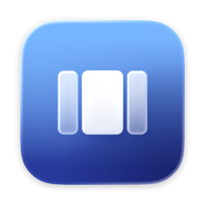

<p align="center">
  
</p>

<h1 align="center">Panes</h1>

<p align="center">Zones for your Mac's windows: pick a layout, hold ⌥ while you drag, and drop windows into place. Made of Liquid Glass.</p>

---

Panes is a menu bar window manager that works like zones on Windows. You pick a layout, such as thirds or a big panel with two columns either side. Then hold ⌥ while you drag any window, and the layout's zones light up under it; let go and the window fills the zone. Keyboard shortcuts and a glass panel in the menu bar move windows through the same zones, so there's one idea to learn instead of dozens of commands.

## Features

- **Layouts:** Halves, Thirds, Four Columns, Quarters, Focus (¼ · ½ · ¼), Main + Side (⅔ and a split ⅓) and Main + Sides (two stacked windows either side of a big one).
- **Draw your own:** click **New** in the panel and drag across a grid of your display to draw zones. They're numbered in the order you draw them. A layout you draw belongs to the display you drew it on; each display has up to nine (see [Layouts](#layouts)).
- **⌥-drag:** hold ⌥ while dragging a window to see the numbered zones in glass, with the target highlighted. Add ⇧ to span from one zone to another, or press Tab to switch layout mid-drag. Let go of ⌥ before you drop for an ordinary move.
- **Edge snap:** drag a window to the left or right edge of the screen for the zone on that side, or to the top to fill the screen. Switch it off in the panel.
- **Swapping:** move a window into a zone another window already fills, and the two swap places.
- **Own size back:** drag a snapped window out of its zone and it returns to the size it had before.
- **Menu bar panel:** the icon shows the active layout. Click it for a glass panel with:
  - every layout as a tile, and **Edit**: drag tiles to reorder them (they wiggle, iOS style), click one to redraw it, delete it, change its shortcut, or **Restore Defaults**
  - the active layout as a board: click a zone to move the window you were using there, or use Fill, Centre or Undo
  - gaps between windows (None, Small, Large or Huge) and switches for edge snapping, Stage Manager and Open at Login
  - **How Panes Works**: a short animated tour of every feature and its shortcuts
- **Stage Manager:** zones leave room for the strip of recent apps, and each stage remembers its own layout. Switch stages and Panes brings back the layout you last used there.

## Shortcuts

| Keys | What it does |
| --- | --- |
| ⌃⌥ ← / → | Move the window to the previous or next zone (wraps around the screen) |
| ⌃⌥ ↑ / ↓ | Move to the zone above or below |
| ⌃⌥⇧ arrow | Grow the window into the next zone in that direction |
| ⌃⌥ 1–9 | Move to zone 1–9 |
| ⌃⌥ ↩ | Fill the screen (keeping the gaps) |
| ⌃⌥ C | Centre at 80% of the screen's width and height |
| ⌃⌥ ⌫ | Undo, stepping back through the last 20 moves |
| ⌃⌥ L | Next layout |
| ⌃⌥⌘ 1–9 | Switch to layout 1–9 on the display you're using, in the panel's order |
| ⌥ while dragging | Show the zones; drop to snap |
| ⇧ with ⌥, while dragging | Span zones |
| Tab while ⌥-dragging | Next layout |

To change a layout's shortcut, open the panel, click **Edit**, click the shortcut under a layout and type the new keys (⌫ removes the shortcut, Esc cancels). In the panel, Tab also switches layout and Esc closes it.

## Download

Get **Panes.zip** from the [latest release](https://github.com/workbyoliver/Panes/releases/latest). It needs macOS 26 Tahoe or later and a Mac with Apple silicon.

1. Unzip it, move **Panes.app** to your Applications folder and open it.
2. The build isn't notarised, so macOS blocks the first launch. Go to System Settings › Privacy & Security, scroll down and click **Open Anyway**. Or run:

   ```bash
   xattr -dr com.apple.quarantine /Applications/Panes.app
   ```

3. Allow Panes in System Settings › Privacy & Security › Accessibility. It needs this to move windows.
4. Turn off macOS's own tiling, or it fights Panes over ⌥-drags and screen edges: System Settings › Desktop & Dock › Windows, switch off the three tiling options. The panel shows a reminder while they're on.

Panes appears in the menu bar, not the Dock.

## Layouts

Click **New** in the panel to draw a layout. The editor shows each of your displays, with the menu bar, Dock and Stage Manager strip shaded (zones never cover them). Pick a display and drag across its grid; the grid follows the display's shape, so halves, thirds and quarters always line up, and **Finer grid** halves the cells. **Undo** removes the last zone, **Reset** clears them, and zones can't overlap.

In **Edit**, drag layouts into the order you want (it's also the order ⌃⌥⌘1–9 use), click one to redraw it, or delete it. **Restore Defaults** brings back the built-in layouts in their usual order, and keeps the ones you drew.

The seven built-in layouts are offered on every display; ones you draw only on the display you drew them on, so a laptop screen and an ultrawide can each have their own.

Layouts are saved in `~/Library/Application Support/Panes/layouts.json`. You can still edit it by hand: each zone's `x`, `y`, `w` (width) and `h` (height) are fractions of the usable screen, from its top-left corner, written as numbers or as text like `"1/3"`, numbered in the order listed. A layout with a `display` is only offered on that display. Saved changes apply straight away, and if the file stops making sense, the panel offers to rewrite it from the layouts in use.

```json
{
  "id": "focus",
  "name": "Focus",
  "zones": [
    { "x": 0, "y": 0, "w": "1/4", "h": 1 },
    { "x": "1/4", "y": 0, "w": "1/2", "h": 1 },
    { "x": "3/4", "y": 0, "w": "1/4", "h": 1 }
  ]
}
```

## Build from source

You'll need:

- macOS 26 Tahoe or later
- Xcode 26 or later (Swift 6.2 and `actool`, which compiles the icon)

Then:

```bash
git clone https://github.com/workbyoliver/Panes.git
cd Panes
make install
```

`make install` builds `build/Panes.app`, copies it to /Applications and opens it. Other targets:

| Command | What it does |
| --- | --- |
| `make run` | Build and run from `build/` |
| `make debug` | Debug build |
| `make zip` | Build `dist/Panes.zip` to send to someone |
| `make clean` | Remove build output |

The build signs the app with your Apple Development certificate if you have one, so macOS keeps Panes's Accessibility permission between builds. Without one it signs ad hoc, and you have to allow Accessibility again after each rebuild. To pick an identity, set `CODESIGN_IDENTITY`.

## Permissions

- **Accessibility:** to move and resize other apps' windows. Panes asks on first launch.

The keyboard shortcuts need no permission.

## How it works

- **Moving windows:** through the Accessibility API. Panes sets the size, then the position, then the size again, and switches off "enhanced user interface" during the move, which otherwise makes some apps animate to the wrong size. Apps with a minimum size are centred in the zone.
- **⌥-drags:** a global mouse monitor notices a window drag, and the window server says which window is moving. The zone overlay is a click-through glass panel placed directly below that window, so it never covers it.
- **Shortcuts:** Carbon hot keys, so the key press never reaches the app in front.
- **Swapping:** the window server lists what's on screen. A window that already fills the target zone moves into the zone yours left.
- **A layout per stage:** macOS has no API for Stage Manager stages, but only the current stage's windows are on screen. Panes remembers your layout for those windows, and when other windows come forward, the layout most of them had comes back. Each app's last layout covers windows Panes hasn't seen, such as after a restart.

## Caveats

- Panes matches Accessibility windows to window-server windows with a private macOS function (`_AXUIElementGetWindow`), as most Mac window managers do, so a macOS update could break it.
- It's only been tested on one display so far.
- Remembering a layout per stage is a best guess from which windows are on screen. After an app or Mac restart it falls back to each app's last layout.
- Builds aren't notarised, so the first launch needs Open Anyway (see [Download](#download)).

## Project layout

```
Sources/Panes/
  PanesApp.swift         app entry point and shortcuts
  Commands.swift         keyboard and panel moves
  HotKeys.swift          Carbon hot keys
  StatusItem.swift       menu bar item and the panel window
  Panel/                 glass panel and its SwiftUI content
  Editor/                the layout editor window
  Tutorial/              How Panes Works
  Layouts/               layouts, zone geometry, layouts.json, shortcuts, per-stage memory
  Drag/                  ⌥-drag and edge snap
  Overlay/               glass zones shown while dragging
  Windows/               Accessibility windows, moving and swapping
Resources/               Info.plist and the Icon Composer app icon
scripts/                 build script and icon generator
```
